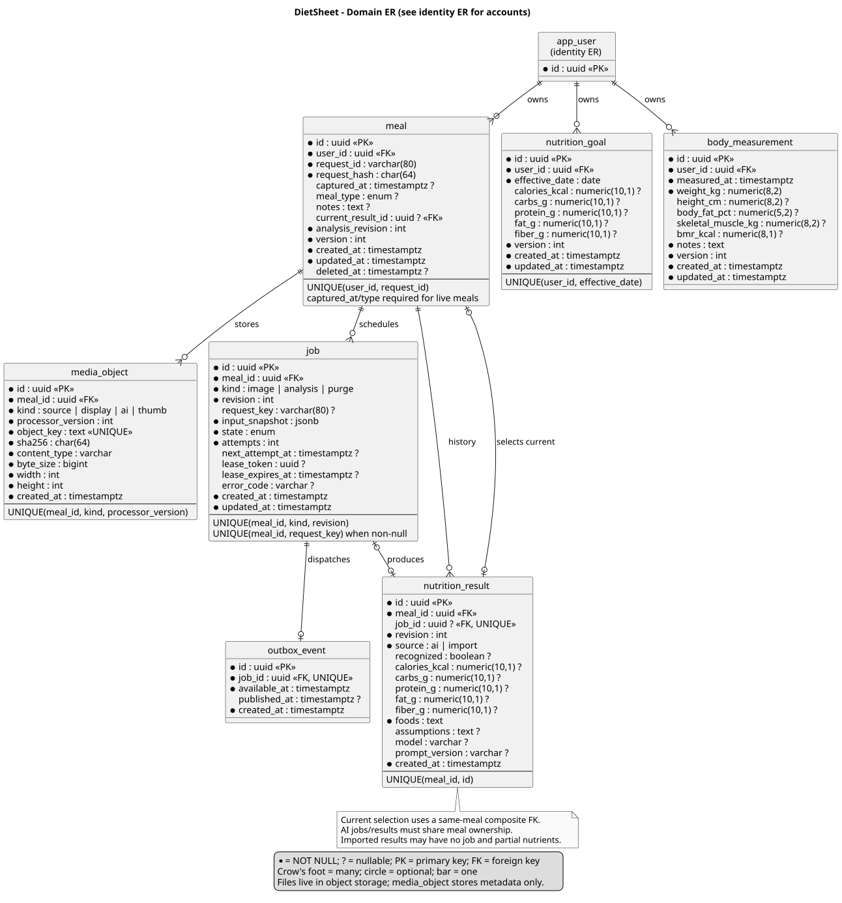
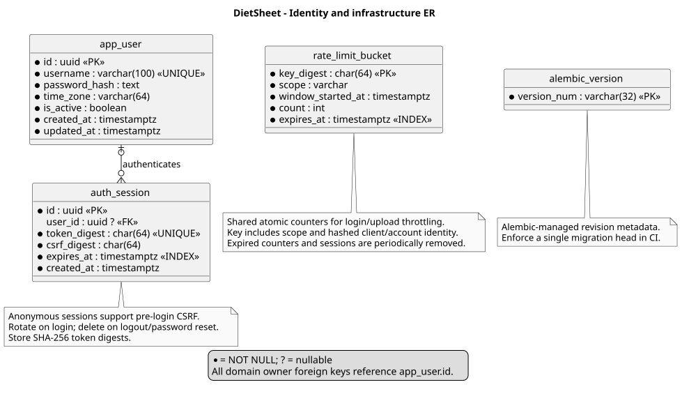

# Data and migration

## Relational model

The [domain ER](diagrams/er-domain.puml) and [identity ER](diagrams/er-identity.puml) cover all proposed tables, including sessions and Alembic version metadata. Beat uses a static schedule; PostgreSQL job rows hold outcomes. No Celery result-backend tables are required.

Application IDs are UUIDs. `?` denotes nullable. Timestamps use UTC `timestamptz`; effective goal dates use the user's IANA timezone, initially `Asia/Taipei`. Keep that reporting timezone fixed in v1. Nutrients are `numeric(10,1)`; physical measurements are `numeric(8,2)` unless indicated.

| Constraint / index | Rule |
| --- | --- |
| Meal ownership | All queries and media requests resolve through authenticated `user_id` |
| Upload deduplication | Unique `(user_id, request_id)`; SHA-256 over normalized submitted metadata and source bytes; conflicts return 409 |
| Meal lookup | Index `(user_id, captured_at, id)` for live meals; partial index on `deleted_at IS NULL` |
| Result selection | Composite FK `(meal.id, current_result_id)` references unique `(result.meal_id, result.id)`; selected result must belong to this meal |
| Result validation | Nullable nutrients represent unknown values; non-null values >= 0; fiber <= carbs when both known; recognized AI output requires all five values, unrecognized output requires all null |
| Job/result relationship | Nullable unique `result.job_id`; AI results require an analysis job belonging to the same meal; imported results have no job |
| Jobs and outbox | Unique `(meal_id, kind, revision)` and `outbox.job_id`; index job `(state, next_attempt_at)`, outbox `(published_at, available_at)` |
| Media | Unique `(meal_id, kind, processor_version)` and object key; positive size/dimensions; original source is version 1 |
| Goal history | Unique `(user_id, effective_date)`; each target is positive or null (disabled); latest effective date <= viewed date wins |
| Measurements | Index `(user_id, measured_at, id)`; positive weight/height, body fat percentage 0..100, other measurements nonnegative; weight required |

Foreign keys restrict accidental physical deletion. Purge explicitly clears `current_result_id`, removes results/outbox/prior jobs/media, then strips meal content while retaining `id`, owner, request ID/hash and deletion timestamps. Retain the completed purge job with an empty input snapshot for status polling. Updates use a `version` counter; serialize competing writes under row locks. Goals and body records have no dependency on meal/AI tables.

BMI and body-fat mass are derived from a measurement's weight/height/fat percentage when available. Store skeletal muscle mass and BMR as entered measurements, not computed dietary targets. Do not automatically persist the hard-coded report from the old UI.

Store Argon2id password hashes via a maintained library such as pwdlib, and SHA-256 digests of cryptographically random session/CSRF tokens. A nullable session owner supports the pre-login CSRF flow. Rotate the session on login and password reset; revoke on logout; expire authenticated sessions after 24 hours and pre-login sessions after 10 minutes. Alembic owns `alembic_version`.

## Object storage

Use a private `diet-media` bucket with immutable keys `users/{userId}/meals/{mealId}/{processorVersion}/{variant}/{uuid}.{ext}`. PostgreSQL holds checksums, dimensions and content types, never image bytes/Base64 or public URLs. Browser access goes through authenticated `/media/{id}`; the API streams the object and supports private conditional caching. The bucket, S3 credentials, source and AI variants are not public.

Database transactions cannot include S3 operations. Persist objects first, then metadata; orphan sweeping handles interrupted writes. Backups must cover both PostgreSQL and S3 data plus SeaweedFS metadata/configuration.

## Google Sheets cutover

1. Back up the Sheet and disable writes and its minute trigger for a final consistent snapshot. Keep it read-only until reconciliation passes.
2. Export all pages with `photos=none`, following `nextAfter`; fetch `photos=data&id=...` per record. Save a local manifest, checksum and import checkpoint. Do not preserve temporary Google image URLs.
3. Preserve original `requestId` as a string (legacy IDs need not be UUIDs). Map the six legacy labels to `breakfast`, `lunch`, `dinner`, `snack`, `late_snack`, `drink`. Preserve timestamps, all five nullable nutrients, notes and food descriptions.
4. The current export omits status, assumptions, model, received/updated timestamps and retry history. Extract those columns in a one-time read-only exporter or mark them unknown; never invent completed statuses. Invalid timestamps/values and missing photos enter a reconciliation report, not silent coercion.
5. Create `source=import` results, retaining partial/null values. Import JPEG bytes as sources and generate derivatives without calling AI. If a legacy ratio differs, pad the derivatives to the nearer allowed ratio; preserve source bytes and record the transformation. No image means no media job.
6. Upsert by owner + legacy request ID; skip unchanged hashes and report changed snapshots for review. Compare IDs, row counts, timezone/day totals, null counts and photo checksums. Resume safely after interruption.
7. Offer an explicit one-time import of browser-local goals with an effective date. Body report values require owner confirmation. Switch the frontend only after reconciliation, then revoke legacy tokens and remove the embedded connection URL during implementation.

No dual-write period. Before new-system writes start, rollback can return to the frozen Sheet. After new writes start, use a new-system backup/restore or an explicit reverse export; silently switching back would lose records.
