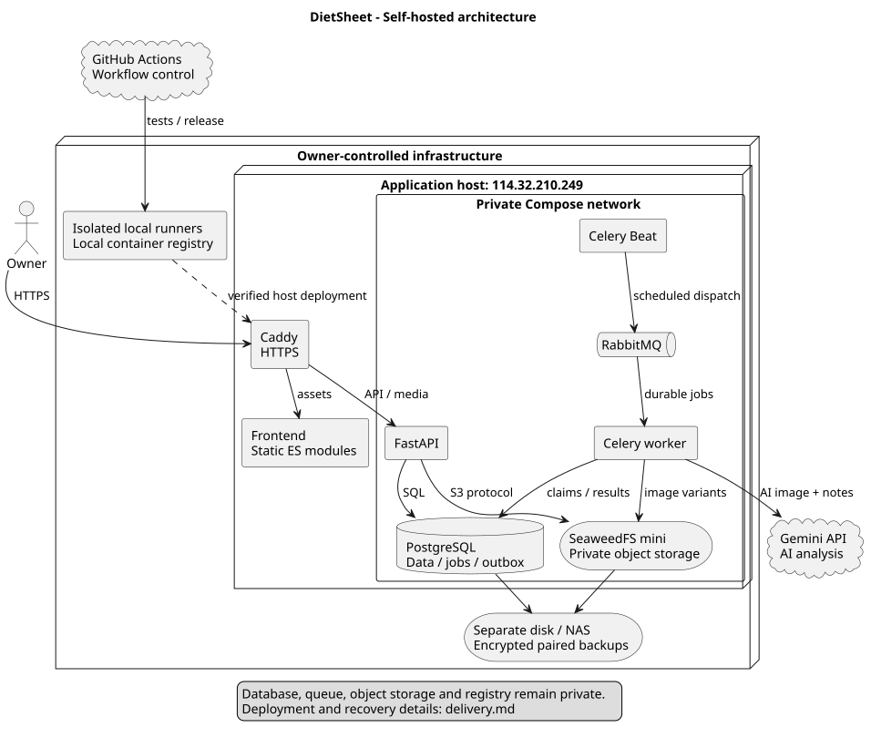
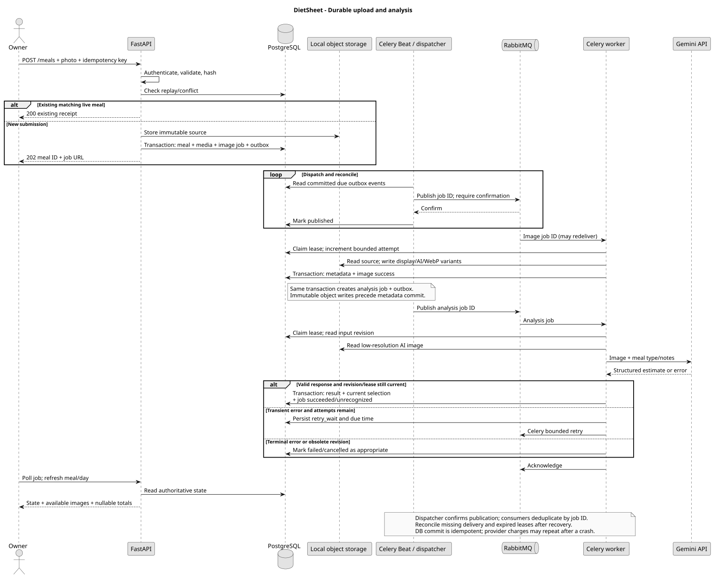

# System design

## Current system

| Evidence | Current behavior | Change |
| --- | --- | --- |
| `index.html`, `src/app.js` | Vanilla ES modules; overview, date selection, meal details, three meals per page | Keep the existing UI; add entry/edit flows and a full-day gallery |
| `src/config.js`, `showSettings()` | Export URL and goals in localStorage; a Google redirect URL in source | Same-origin `/api/v1`; server-owned goals; remove data-connection settings |
| `index.html`, `renderBody()` | Hard-coded body report | Dated measurements with history and corrections |
| `renderEnergy()`, `renderNutrients()` | Percentage text exceeds 100%; donut/bar geometry is capped | Make overflow visually proportional |
| `src/data.js` | Fetches export pages, then filters and aggregates in the browser | Date-scoped reads and server-side summaries |
| `src/styles.css` | Grayscale, dark sidebar, pale background, rounded white cards; square thumbnails and fixed-height detail crops | Retain style; preserve 3:4 and 4:3 photo ratios |
| Supplied Apps Script | JPEG up to 600 KiB, Base64 split across 21 cells; token-authenticated upload/export | Binary uploads, private object storage and session authentication |
| Supplied `processQueue()` | Minute trigger claims one record; leases and up to three attempts | Durable framework queue with idempotent workers |
| Supplied export | Nutrient nulls preserved; temporary photo URLs; limited analysis metadata | Explicit processing state, uncertainty and stable authenticated media URLs |

The baseline consists of the frontend repository and the separately supplied Apps Script. Use synthetic documentation fixtures.

## User journeys and presentation

| Journey | Intended behavior |
| --- | --- |
| Sign in | Owner account provisioned by the operator |
| Record a meal | Choose photo, capture time, meal type and notes; show saved/processing immediately; retry a failed analysis |
| Review a day | Overview links to `/day/YYYY-MM-DD`; chronological gallery groups all six meal types, with totals and pending/failed states |
| Review one meal | Full uncropped display image, nutrients, notes, model and uncertainty; edit metadata or delete |
| Update body data | Enter measurement time and values; newest measurement drives sidebar; history supports corrections and deletion |
| Update nutrition goals | Save five nutrient targets with an effective date; display the goal applicable to the viewed date |

The gallery automatically follows API cursors and appends cards on the same scrolling page. It shows a loaded/total count until complete; failed page loads offer retry. Load all records and lazy-load their images.

Keep `#222` sidebar, `#f4f4f4` background, `#252525` text, soft borders and existing typography. Self-host the font files currently loaded from Google Fonts. Keep the product UI in Traditional Chinese; documentation and diagrams stay English. Make body/goal actions available on mobile. Use keyboard navigation, visible focus, textual chart alternatives and scrollable meal details.

### Required responsive layouts

Sizes below are CSS browser viewport pixels. Adapt layout to the available viewport, including the reduced height of a Mac browser with the Dock visible.

| Layout | Rule | Acceptance viewports | Behavior |
| --- | --- | --- | --- |
| Standard desktop | width >= 1000, height > 800 | 1440x900, 1920x1080 | Sidebar, four stats, paired charts and panels |
| Mac with Dock / compact desktop | width >= 1000, height <= 800; extra compact at <= 680 | 1440x760, 1280x640 | Tighter gaps and headings; page scroll when needed; keep chart labels and actions visible |
| Phone | width <= 700 | 390x844, 360x640, 844x390 landscape | Header navigation, two stat columns, stacked panels, single-column gallery and full-width forms |

The 701..999 px tablet range bridges layouts with two gallery columns; landscape phones in this range use the same safe, scrolling layout. Desktop gallery uses three columns, compact desktop two or three depending on card width. Every photo keeps its own 3:4 or 4:3 ratio. Use `min-height`, safe-area insets and normal scrolling. Dialogs fit `calc(100dvh - 24px)` and scroll internally. Verify 200% zoom, long food descriptions, phone keyboard and Dock-visible Safari manually in addition to viewport tests.

**Progress:** calculate `percent = actual / target * 100`, preserving values above 100%. Use a compact linear energy gauge. Give energy and nutrient gauges a 100% target marker and a hatched overflow segment; use `axisMax = max(100, ceil(percent / 50) * 50)`. Scale both marker and fill to that axis and print the exact percent and excess amount. Thus 150% fills beyond the target and 300% remains distinguishable. Overflow shows the amount above the target.

Missing targets disable progress; missing nutrition remains unknown. Partial totals show known amounts plus missing counts. Trend lines leave unknown days blank and use each day's effective target. Nutrition goals are updated through their own form. Future-dated targets are allowed; editing an existing effective date explicitly corrects that historical target. Dates before the first saved target display an unset goal.

## Architecture

| Component | Proposed choice and responsibility |
| --- | --- |
| Frontend | Existing ES modules/CSS; Vite for asset builds; small API, state, chart, gallery and form modules |
| API | FastAPI + Pydantic, SQLAlchemy 2 and Alembic; validation, authorization, transactions, summaries and migrations |
| Database | PostgreSQL; authoritative business data and job state |
| Queue | Celery + RabbitMQ; delivery, acknowledgements, retries, routing and worker lifecycle |
| Object storage | SeaweedFS `weed mini`, private S3 API; a replaceable S3 adapter |
| Images | Pillow; deterministic, versioned transformations |
| AI | Gemini adapter; configurable model, structured output validation; server-side credentials |
| Edge | Caddy HTTPS proxy; static frontend service; `/api` and `/media` to API |

FastAPI provides validation and OpenAPI integration; Alembic manages schema revisions. Celery handles durable background work. SeaweedFS mini provides a compact S3 deployment, with explicit credentials. Pin tested releases and container digests at implementation. [FastAPI](https://fastapi.tiangolo.com/), [Alembic](https://alembic.sqlalchemy.org/en/latest/tutorial.html), [Celery/RabbitMQ](https://docs.celeryq.dev/en/stable/getting-started/backends-and-brokers/rabbitmq.html), [SeaweedFS mini](https://github.com/seaweedfs/seaweedfs/wiki/Quick-Start-with-weed-mini), [S3 credentials](https://github.com/seaweedfs/seaweedfs/wiki/S3-Credentials).

Use one modular backend: `accounts`, `meals`, `media`, `nutrition`, `measurements`, `jobs`. HTTP handlers validate inputs and call application services; workers call the same services. Keep image transformation, nutrient calculation and provider calls independent.

Run stateless API replicas and separate image/AI workers only when load requires it. Compute daily totals using indexed, bounded queries. One physical host remains a single point of failure.

## Images and background work

Accept JPEG, PNG or WebP up to 15 MiB and 24 megapixels. Verify decoded content, reject animation and unsupported codecs, apply EXIF orientation, then validate ratio as 3:4 or 4:3 within one pixel of rounding. The UI previews the selected crop; the server preserves the submitted framing.

| Variant | Proposed encoding | Use |
| --- | --- | --- |
| `source` | Uploaded bytes; private, immutable | Private source for regenerating derivatives |
| `display` | JPEG quality 90, longest edge <= 2560 px | Individual meal view |
| `ai` | JPEG quality 75, longest edge <= 1024 px, <= 600 KiB | Provider input; lower quality/size until under budget |
| `thumb` | WebP quality 75, longest edge <= 480 px | Gallery and dashboard |

Limit output dimensions to the source dimensions. Strip metadata from all derivatives, convert to sRGB, flatten transparency on white, and retain ratio. Store dimensions to reserve layout space; use `aspect-ratio` and `object-fit: contain`. Quality limits require verification on real food photos. Imported image quality is limited by the source. [Pillow orientation operations](https://pillow.readthedocs.io/en/stable/reference/ImageOps.html).

1. API authenticates and validates upload; stores source under a unique staging key. In one DB transaction, create meal, source metadata, image job and outbox event. Respond `202` after persistence; AI analysis runs asynchronously.
2. Celery Beat schedules outbox dispatch/reconciliation every 10 seconds. Dispatcher publishes persistent messages with publisher confirms, then marks the event published. A crash between these steps may duplicate delivery.
3. Workers atomically claim a job with a lease and increment its DB attempt counter. Write derivatives before publishing metadata. One transaction finishes the image job and creates the analysis job/outbox event (except imports, whose job snapshot sets `analyzeAfter=false`). The AI job receives only the low-resolution derivative and user meal data. The analysis endpoint also retries failed image processing from its saved source.
4. Persist a validated result and select it as current only if the meal's analysis revision still matches. A newer edit, reanalysis or deletion fences out an old worker. Polling clients refresh the meal and day totals.

Job states: `queued -> running -> succeeded | unrecognized | retry_wait | failed`; `retry_wait -> running`; obsolete jobs become `cancelled`. `unrecognized` applies to analysis jobs. Use late acknowledgement, prefetch 1, 120-second hard task limit, 180-second lease and bounded provider timeouts. Retry transient timeouts/429/5xx with jitter (about 30/120 seconds; respect bounded Retry-After), at most three total attempts. Invalid images and credential failures stop immediately. Persist attempts across redelivery; terminal tasks are no-ops. [Celery task semantics](https://docs.celeryq.dev/en/stable/userguide/tasks.html).

Reconciliation republishes overdue queued/retry jobs and expired leases, using the same job identity and DB attempt cap. After broker recovery, Beat resumes dispatch from PostgreSQL. This is at-least-once processing: result commits are deduplicated, but an interrupted provider call may incur a second charge.

Use immutable object keys and unique `(meal, variant, processorVersion)` metadata. Sweep unreferenced staging/derivative objects after 24 hours, excluding live job leases. A deleted meal is immediately hidden; a `purge` job deletes every object prefix before removing media metadata, prior jobs and results. Keep a minimal deleted-meal tombstone for upload idempotency and its sanitized terminal purge job for polling. Object failures leave a retriable purge while the meal stays hidden.
